# UX/UI · Usabilidad · Accesibilidad

**UT 2 – Diseño y desarrollo web – 3º EAS Diseño Gráfico**

> Fuente: `UX UI Accesibilidad presenteación.pdf` (169 diapositivas).
> - `imagenes/` → imágenes originales extraídas del PDF a su resolución nativa (nombre: `img-dNNN-KK` = diapositiva donde aparece por primera vez + orden).
> - `diapositivas/` → cada diapositiva renderizada en alta definición (2160 × 1215 px, JPG).
>
> Las diapositivas que se revelan progresivamente (mismo contenido ampliado paso a paso) se han unificado en su versión completa, indicando el rango.

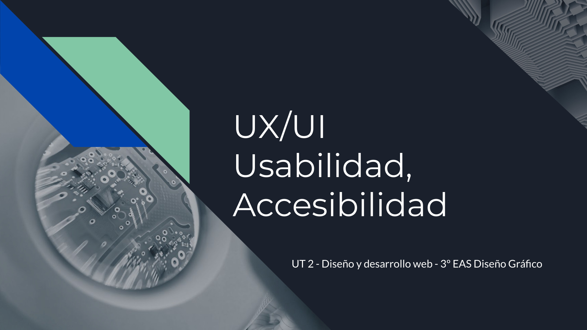

---

## 1. Introducción: los profesionales del diseño web

### Muchos profesionales trabajando juntos
[Diapositiva 2](diapositivas/diapositiva-002.jpg)

La industria del diseño y desarrollo web es un campo donde trabajan un grupo de profesionales extenso y variado.

### Relaciones constantes
[Diapositiva 3](diapositivas/diapositiva-003.jpg)

Estos desarrollan roles diversos, complementarios, en constante relación y, a veces, fricción.

### ¿De qué hablamos cuando hablamos de…?
[Diapositiva 4](diapositivas/diapositiva-004.jpg)

Es importante tener un panorama general, conocer qué hace cada uno, pues nos permitirá orientarnos mejor y saber cuál es nuestro cometido y con quién podemos colaborar para determinados objetivos.

---

## 2. Conceptos previos: productos digitales

[Diapositivas 5–9](diapositivas/diapositiva-005.jpg)

| Producto | Objetivo principal | Tarea más importante que hacen los usuarios |
|---|---|---|
| **Sitio web** | Entregar información | **CONSUMIR INFORMACIÓN** |
| **App** | Realizar una tarea (en un programa instalado en el dispositivo) | **ORDENAR / EJECUTAR UNA ACCIÓN** |
| **Aplicación web** | Realizar una tarea (mediante un navegador web) | **ORDENAR / EJECUTAR UNA ACCIÓN** |

---

## 3. UI, UX: ¿qué son? ¿cuál es la diferencia?

[Diapositiva 10](diapositivas/diapositiva-010.jpg)

[Diapositiva 11](diapositivas/diapositiva-011.jpg) · Fuente: www.uxables.com

| UX | UI |
|---|---|
| Investigación con usuarios | Diseño de interacción |
| Arquitectura de información | Diseño visual y gráfico |
| Diseño de wireframes | Definición de tipografías |
| Realización de test A/B | Sistemas de diseño |

---

## 4. Experiencia de usuario (UX)

### Foco en ordenadores: UX – *User experience*
[Diapositiva 12](diapositivas/diapositiva-012.jpg)

**Experiencia de usuario:** experiencia que tiene una persona al interactuar con todos los aspectos del producto de una empresa. **Antes, durante y después.**

### Diseñadores de UX
[Diapositiva 13](diapositivas/diapositiva-013.jpg)

Se centran en el estudio del usuario, especialmente en su **percepción** y las **sensaciones** que le genera el producto o servicio digital **a través de las interacciones** que realiza.

### UX, factores determinantes
[Diapositiva 14](diapositivas/diapositiva-014.jpg)

1. **Cómo ha descubierto** la empresa/producto y cómo ha llegado hasta él.
2. El **camino de interacciones** que realiza en la interfaz para conseguir su propósito.
3. **Pensamientos y sentimientos** que le surgen en el proceso.

### ¿Qué es una BUENA experiencia de usuario?
[Diapositiva 15](diapositivas/diapositiva-015.jpg)

La que garantiza que el producto/servicio web **satisface las necesidades del cliente/usuario** con una experiencia positiva.

Puede ser para: informarse, comprar, reservar, contactar con otros, etc.

### La diseñadora UX no trabaja sola
[Diapositiva 16](diapositivas/diapositiva-016.jpg)

Para poder comprender el negocio, la empresa y a los usuarios, colabora con:

1. Investigadores de UX
2. Departamento comercial
3. Diseñadores UI
4. Marketing

### Actividades de un diseñador UX
[Diapositiva 17](diapositivas/diapositiva-017.jpg)

Un diseñador UX realiza, entre otras, las siguientes actividades:

- **Investigaciones** (test con usuarios, card sorting, tree test, five second test, personas, focus group, etc.).
- **Evaluaciones** (análisis heurísticos).
- **Análisis de datos** (test A/B).
- **Arquitectura de información.**
- **Wireframes.**

### Recapitulamos: el propósito del diseñador UX
[Diapositiva 18](diapositivas/diapositiva-018.jpg)

El objetivo del/la diseñador/a de UX es poner el foco en el usuario, en sus verdaderas motivaciones y necesidades, para definir la experiencia que lo satisfaga:

- qué interfaz
- qué contenidos
- qué interacciones

Para favorecer que este consuma el producto y lo perciba como:

- útil
- usable
- deseable.

### Conceptos clave de UX
[Diapositiva 19](diapositivas/diapositiva-019.jpg)

- Centrado en el usuario.
- Para qué está en la web, qué espera.
- Motivaciones y necesidades.
- Selección de contenidos, estructuras, interacciones…
- Análisis previo y posterior.

---

## 5. Investigación

> **“Preguntar es mejor que suponer”.**
[Diapositiva 20](diapositivas/diapositiva-020.jpg)

### Qué queremos saber
[Diapositiva 21](diapositivas/diapositiva-021.jpg)

Si antes de crear una interfaz hay que conocer bien a las personas que la van a usar… **¿Cómo podemos investigar a nuestro target?**

### Técnicas
[Diapositivas 22–23](diapositivas/diapositiva-022.jpg)

**Cualitativas (explorar y comprender):**

- **Entrevistas:** hablamos directamente con usuarios para entender sus necesidades e ideas.
- **Observación:** miramos cómo usan apps parecidas, sin intervenir.
- **Focus group:** preguntamos a varias personas a la vez, comparten opiniones en grupo.

**Cuantitativas (medir y validar):**

- **Encuestas:** preguntamos a muchas personas y vemos, con datos, qué opinan o cómo actúan.
- **Personas:** creamos personajes ficticios que representan a diferentes tipos de usuarios.

### Importancia
[Diapositiva 24](diapositivas/diapositiva-024.jpg)

Investigar lleva tiempo y recursos, pero **es una inversión**.

Si entendemos bien a nuestro público, diseñamos soluciones que de verdad les ayudan.

### Reparto de técnicas (actividad de clase)
[Diapositiva 25](diapositivas/diapositiva-025.jpg)

Técnicas a investigar y exponer en clase:

- Test de usuarios
- Card sorting
- Tree test
- Five second test y Focus group
- Personas
- Análisis heurístico
- Test A/B

---

## 6. Patrones humanos

> **“Tampoco somos tan diferentes...”**
[Diapositiva 26](diapositivas/diapositiva-026.jpg)

### Únicos pero predecibles
[Diapositivas 27–28](diapositivas/diapositiva-027.jpg)

Aunque cada persona piensa de forma única, hay hábitos y formas de actuar que muchas personas repiten cuando usan una interfaz.

Diseñadores, psicólogos, ingenieras de software, investigadoras en marketing y publicidad, etc. llevan años observando cómo usamos apps y webs y cómo mejorar los resultados.

**Sabemos que hay ciertos patrones que la mayoría de usuarios seguimos sin darnos cuenta.** Por ejemplo:

- Esperamos que el botón “Aceptar” esté abajo, mejor a la derecha.
- Los menús los esperamos arriba o a la izquierda.
- Si algo parece un enlace azul, queremos hacer clic.

### Patrón: Exploración segura
[Diapositiva 29](diapositivas/diapositiva-029.jpg)

Nos gusta probar cosas en una app sin miedo a “romper” nada.

- Si sé que puedo **deshacer** o **volver** atrás, pruebo más funciones y aprendo mejor.
- Usar la app resulta más divertido y da **confianza**.
- Si no se puede deshacer pido **confirmación**.

**¿Cómo le doy seguridad al usuario?**

- La app debe mostrar siempre qué está pasando (visibilidad).
- Lo que ocurre debe tener sentido y parecerse a la vida real.
- El usuario debe tener el control y ser libre de deshacer o equivocarse sin problema.

*Principios heurísticos de Jakob Nielsen (hay más).*

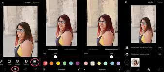

### Patrón: Gratificación instantánea
[Diapositiva 30](diapositivas/diapositiva-030.jpg)

Queremos ver siempre los resultados RÁPIDO.

Si tu app muestra resultados o beneficios al instante, la gente se engancha y confía más en ella.

Si algo funciona bien y nos sorprende al principio, confiamos más en la aplicación, vemos su utilidad y queremos seguir usándola.

**¿Qué hacen los buenos diseñadores?**

- Piensan cuál será la primera acción del usuario y la ponen súper fácil.
- Dan acceso inmediato a lo que importa, sin pedir mil datos al principio… lo tedioso vendrá después… (registro o formulario de compra, ¿recuerdas?).

**Ejemplos:**

- En Shazam, lo primero que ves es el botón “Escuchar”.
- En YouTube o TikTok, puedes ver contenido antes de registrarte. Solo piden crear cuenta para acciones secundarias: ya has visto lo que te interesa.

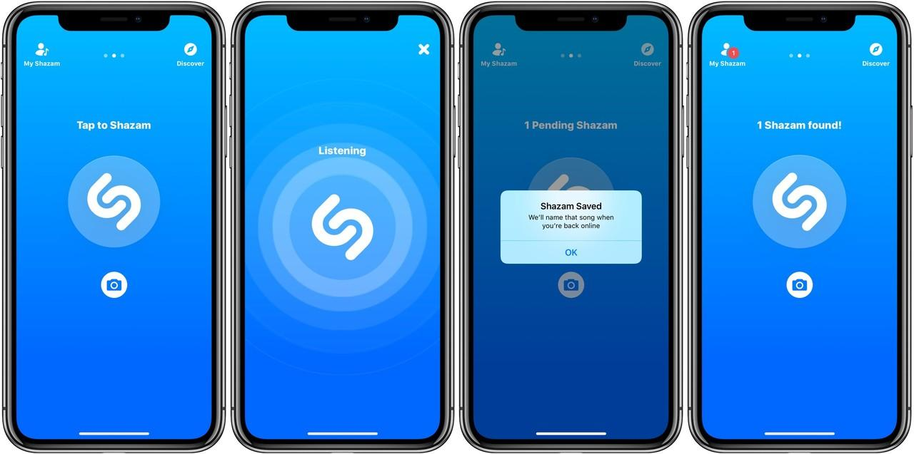

### Patrón: Elecciones postergadas
[Diapositivas 31–32](diapositivas/diapositiva-031.jpg)

Si a un usuario se le pide hacer cuestiones complejas para completar una tarea podría preferir saltarse ese paso ahora para volver más tarde.

Al registrarnos en una web, nos piden nombre, email, foto, preferencias... pero muchas veces podemos dejarlo para después y usar la app antes.

**¿Qué se debe permitir al usuario?**

1. Conseguir la atención, la emoción y fidelización del usuario.
2. Ahora la tarea es importante para el usuario.
3. Pediré la parte más molesta del proceso.

Las aplicaciones deben dejar que el usuario decida cuándo quiere completar detalles poco importantes para él, para avanzar rápido y no perder tiempo.

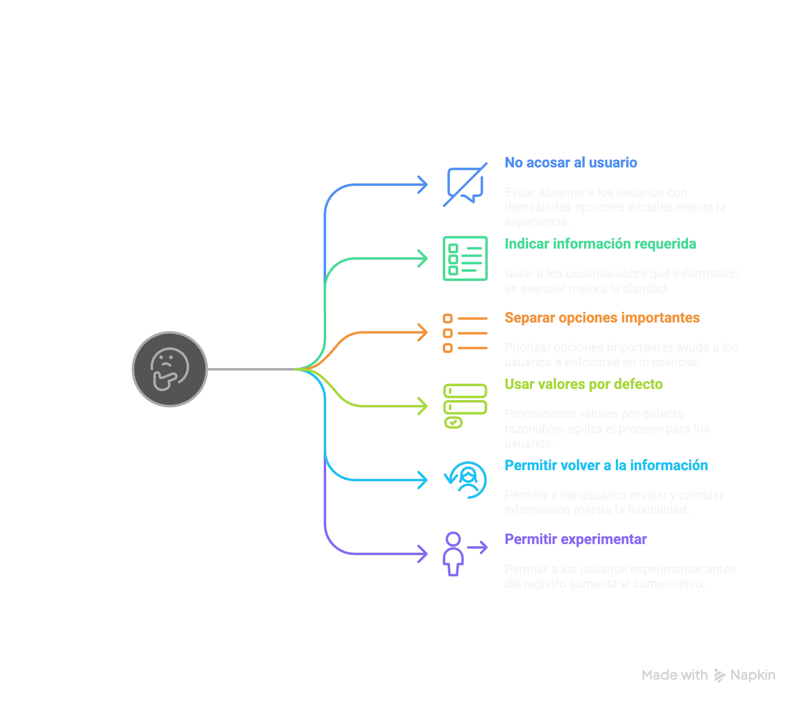

Estrategias del esquema:

- **No acosar al usuario:** evitar abrumar a los usuarios con demasiadas opciones iniciales mejora la experiencia.
- **Indicar información requerida:** guiar a los usuarios sobre qué información es esencial mejora la claridad.
- **Separar opciones importantes:** priorizar opciones importantes ayuda a los usuarios a enfocarse en lo esencial.
- **Usar valores por defecto:** proporcionar valores por defecto razonables agiliza el proceso para los usuarios.
- **Permitir volver a la información:** permitir a los usuarios revisar y cambiar información mejora la flexibilidad.
- **Permitir experimentar:** permitir a los usuarios experimentar antes del registro aumenta el compromiso.

### Patrón: Micro-interrupciones
[Diapositiva 33](diapositivas/diapositiva-033.jpg)

No significa que la app tenga interrupciones. De lo que hablamos es de que muchas aplicaciones están pensadas para momentos cortos: permiten hacer algo útil o divertido enseguida y retomar cuando vuelvas, sin líos.

- Mirar notificaciones o email.
- Consultar redes sociales.
- Leer noticias, ver un vídeo corto.
- Jugar una partida rápida.
- Buscar algo en Google.

**¿Qué se debe permitir al usuario?**

La app debe funcionar rápido, de forma sencilla y ofrecer lo más útil en la primera pantalla. Sin configuraciones complicadas ni tiempos de espera largos.

Si la app tarda mucho en cargar, el usuario se va.

Las redes sociales triunfan, entre otras cosas, porque puedes entrar, hacer algo y salir, sin demora.

### Patrón: Satisficing (satisfactorio y suficiente)
[Diapositiva 34](diapositivas/diapositiva-034.jpg)

Si algo parece útil lo probamos sin pensarlo mucho.

Al usar una app o web nueva, no leemos las opciones una por una. Miramos rápido y elegimos la primera opción que parece ayudarnos.

**¿Por qué ocurre esto?** Somos vagos. Queremos cumplir el objetivo rápido, bien y sin pensar mucho.

Un ejemplo claro de esto son los *call to action*: “Empezar aquí”, “Compra ahora”, “Reserva tu plaza ahora”, “Escribe tu nombre...”, “Sube tu imagen”.

Usa etiquetas cortas y fáciles de entender a la primera. Elige un diseño claro, ordenado y sencillo. Así el usuario sabe hacia dónde ir. Facilita avanzar, retroceder o salir si se equivocan. Si la interfaz es complicada, la gente se pierde y se frustra.

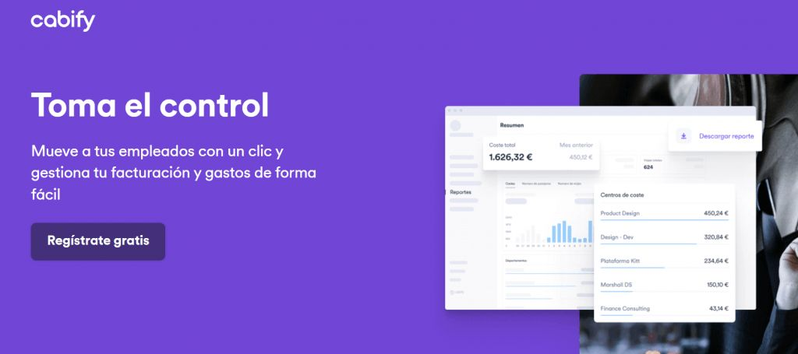

### Patrón: Cambios sobre la marcha
[Diapositiva 35](diapositivas/diapositiva-035.jpg)

Podemos empezar usando una app con un objetivo y, sin darnos cuenta, cambiar lo que queremos.

Una buena interfaz permite que el usuario **cambie de objetivo o recupere su trabajo** en cualquier momento, sin complicaciones.

**¿Qué se debe permitir al usuario?**

- Cambiar de idea, retroceder, avanzar, salir y probar otras opciones **sin sentirse “atrapado”**.
- **No bloquear al usuario:** que siempre pueda moverse hacia otras páginas o funciones si lo necesita y recuperar algo que dejó a medias (un proceso de compra…).

**Ejemplo:** entro en Amazon para ver un móvil y acabo comprando unos auriculares o los dos.

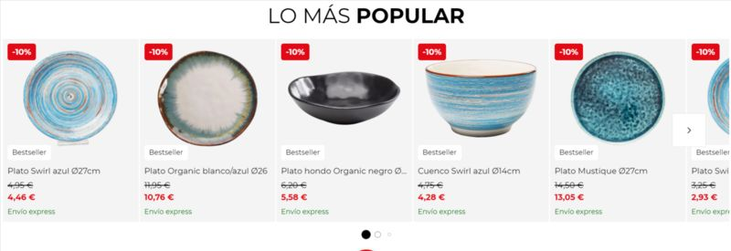

### Patrón: Construcción incremental
[Diapositiva 36](diapositivas/diapositiva-036.jpg)

Cuando la gente crea algo complejo (como una web o un diseño), no sigue siempre un orden fijo.

En vez de hacer todo de golpe, empezamos con una parte pequeña, la probamos, la arreglamos y luego seguimos con otra parte.

Más tarde las uniremos, relacionaremos o pondremos en orden.

**¿Qué se debe permitir al usuario?** Construir y mejorar poco a poco, probando y corrigiendo mientras avanzamos. **El feedback es imprescindible.**

**Ejemplo:** el panel de control de WordPress te deja construir tu web por partes: puedes crear una página, probar cómo queda, hacer cambios y pasar a la siguiente.

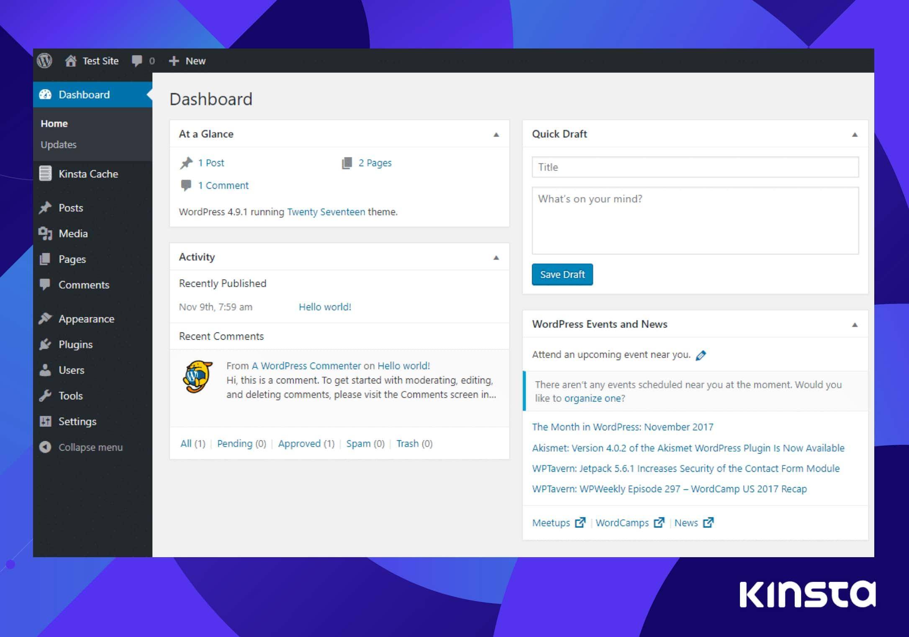

### Patrón: Habituación
[Diapositivas 37–38](diapositivas/diapositiva-037.jpg)

Si usas apps o webs habitualmente te acostumbras a que algunas acciones tienen un comportamiento específico.

- Pulsar CTRL+S para guardar.
- Presionar ENTER para aceptar o introducir.
- Hacer clic en el logo para volver al inicio.
- Usar gestos en el móvil para ampliar cosas.

**¿Qué se debe permitir al usuario?** Utilizar todo lo que sabe de otras apps o del mundo físico y **sentirse un experto** nada más entrar.

Si algo funciona distinto a lo que esperabas (por ejemplo, el atajo no guarda el archivo), te puedes confundir y perder tiempo.

**En resumen:** la costumbre de hacer las mismas acciones (habituación) te hace más ágil, y la interfaz debe ser siempre “predecible” para no romper esa rutina.

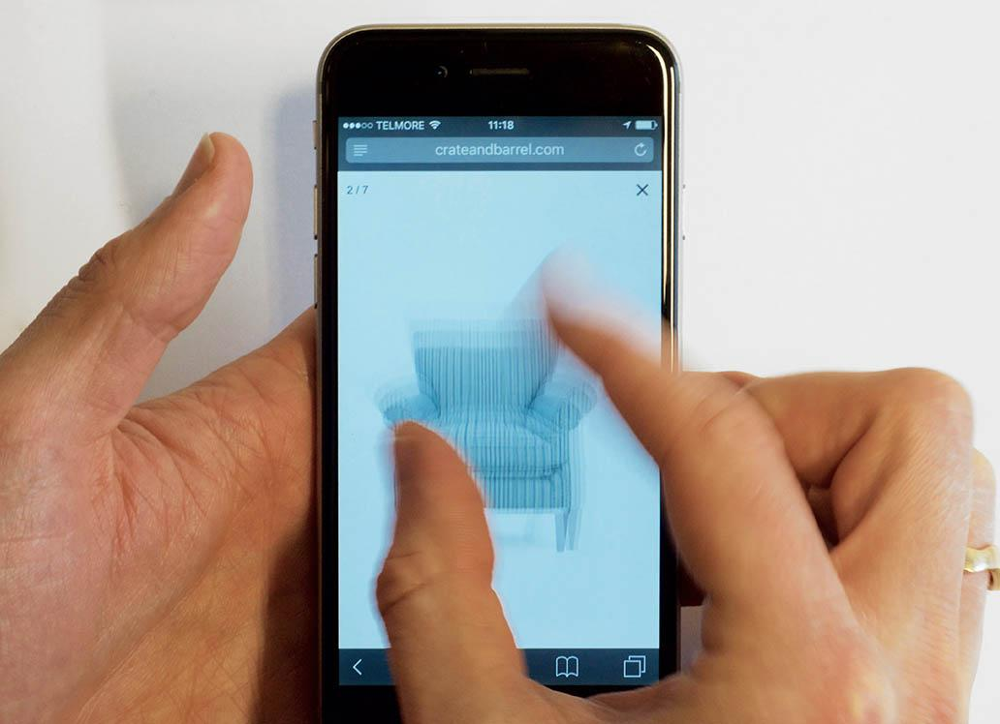

Ejemplos de ventanas modales con la disposición habitual de botones (cancelar / confirmar):

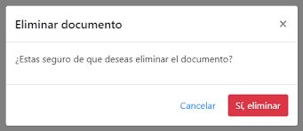
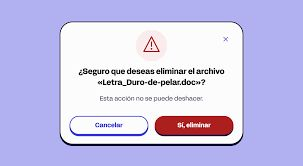
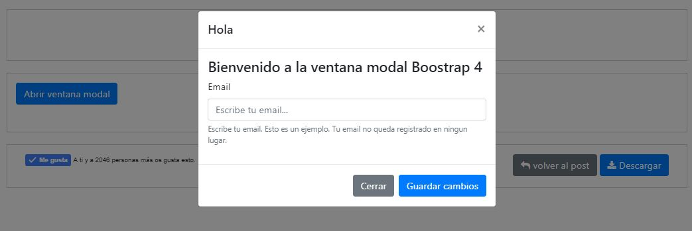

### Patrón: Memoria espacial
[Diapositiva 39](diapositivas/diapositiva-039.jpg)

Muchas veces recordamos dónde está algo por su posición más habitual.

En apps y webs, los botones como “OK” o “Cancelar” suelen estar siempre en el mismo sitio. Esto ayuda a que los encontremos sin pensar.

En barras de herramientas, menús y jerarquías, la posición es clave: encontramos lo que buscamos sobre todo por “dónde está”.

**¿Qué se debe permitir al usuario?**

- Que encuentre lo que busca donde normalmente suele encontrarlo situado.
- Si algo no es habitual, pero es importante, que esté accesible más rápido y sin esfuerzo. ¿Dónde?
- Si quieres que la gente vea algo importante, ponlo al principio o al final, porque se recuerda más.
- Los elementos deben mantener su posición (consistencia).

### Patrón: Memoria prospectiva
[Diapositivas 40–42](diapositivas/diapositiva-041.jpg)

Es la capacidad de recordar que tienes que hacer algo en el futuro y luego hacerlo de verdad. Hay aplicaciones específicas para ello.

> ¿Qué apps conoces que estén pensadas para esta necesidad?

- Calendarios
- Alarmas y recordatorios
- Gestores de tareas
- Gestión de listas de lectura
- Notas
- En cualquiera, marcar favoritos.

**¿Qué se debe permitir al usuario?** Flexibilidad y personalización:

- Dejar a la vista elementos.
- Dejar abiertas ventanas o pestañas.
- Marcar elementos como importantes o pendientes.
- Organizar elementos de varias formas o libre.
- Guardar elementos como favoritos.
- Tener información a mano.
- Hacer anotaciones en elementos.
- Guardar datos en un proceso inacabado.
- Abrir recientes o por donde lo dejó.

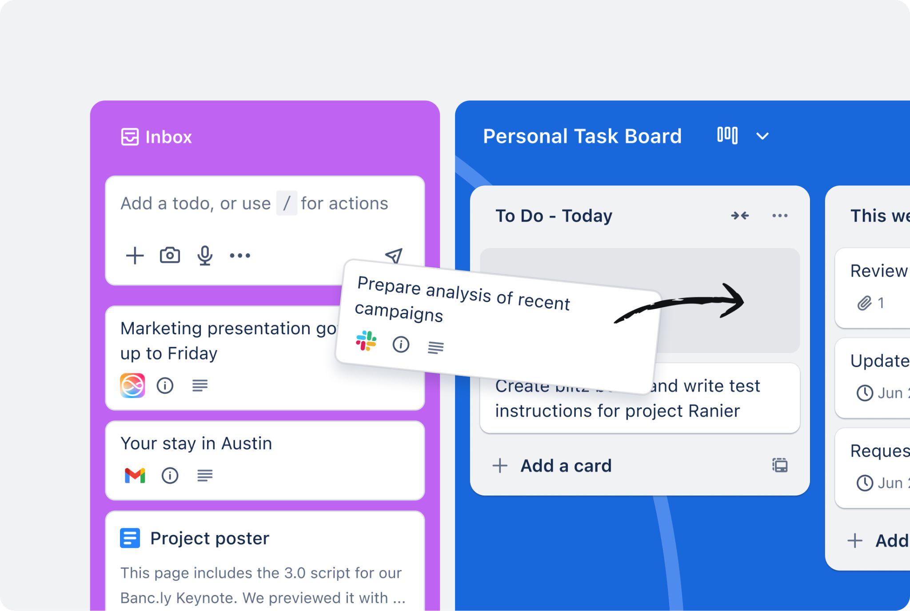
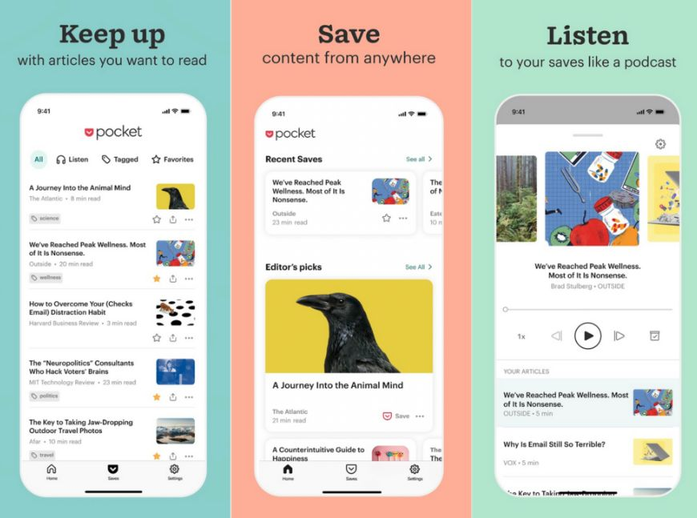

### Patrón: Simplificar la repetición
[Diapositiva 43](diapositivas/diapositiva-043.jpg)

Si un usuario debe repetir algo muchas veces, debes buscar la manera de simplificarlo, automatizarlo o que se divierta haciéndolo.

**¿Qué se debe permitir al usuario?** No repetir tareas y, si es inevitable, que estas sean súper fáciles y no cansen.

**¿Cómo elimino repeticiones en una app?**

- La principal: acorta el camino para conseguir una acción, que no conlleve muchos clics.
- Usa como referencia herramientas comunes para repetir acciones rápido:
  - **Buscar y reemplazar:** cambia texto por otro en todo el documento de una sola vez.
  - **Acciones en Photoshop:** aplica el mismo efecto a varias fotos con un solo clic.
  - **Macros o scripts:** repiten una secuencia de pasos, ahorrando tiempo.
  - **Copiar-pegar, atajos de teclado, marcadores:** todo lo que agiliza las tareas y evita repetir movimientos.

### Patrón: Uso del teclado
[Diapositiva 44](diapositivas/diapositiva-044.jpg)

No todo el mundo puede o quiere usar el ratón o el dedo.

Algunas personas tienen problemas físicos, otras prefieren ser rápidas usando el teclado, o no pueden ver la pantalla y usan programas que leen lo que hay en ella.

**¿Qué se debe permitir al usuario?** Tener siempre elementos de texto y permitir la interacción con el teclado (accesibilidad, *“Design for All”*).

**¿Qué facilidades se suelen encontrar?**

- **Atajos de teclado:** combinaciones de teclas (como CTRL+S) para hacer acciones rápido.
- **Navegación por listas:** usar flechas y MAYÚS para moverse y elegir varias cosas a la vez.
- **TAB:** permite saltar de un campo a otro en los formularios.
- **Radio buttons y controles:** se pueden marcar usando flechas, ENTER o SPACE.
- **Cerrar ventanas:** además del ratón, puedes usar ENTER en los diálogos modales.

### Patrón: Social media
[Diapositivas 45–46](diapositivas/diapositiva-045.jpg)

Somos sociales por naturaleza: nos gusta saber qué hacen los demás y buscamos sentirnos parte de un grupo.

- Buscamos opiniones de otros antes de comprar.
- Nos atrae lo que otros compraron con este o aquel producto.
- Buscamos recomendaciones (amigos, conocidos o incluso desconocidos).
- Compartimos ideas, imágenes, eventos…
- Queremos confirmar que nuestras decisiones son correctas según lo que piensan los demás: *“Social Proof”*.

**¿Qué se debe permitir al usuario?**

- Comentar y valorar (estrellas, likes) para ayudar a otros.
- Compartir contenido (textos, fotos, vídeos), comentar y valorar el contenido de otros.
- Fomentar la colaboración: chats, debates, trabajo en grupo, videollamadas, etc.

**¿Por qué es importante en las aplicaciones?** Compartir, comentar o ver el feedback de otros hace una app más popular. Los usuarios se sienten escuchados o creadores y pasan más tiempo usándola. Cualquier aplicación puede tener un apartado o funciones sociales integradas.

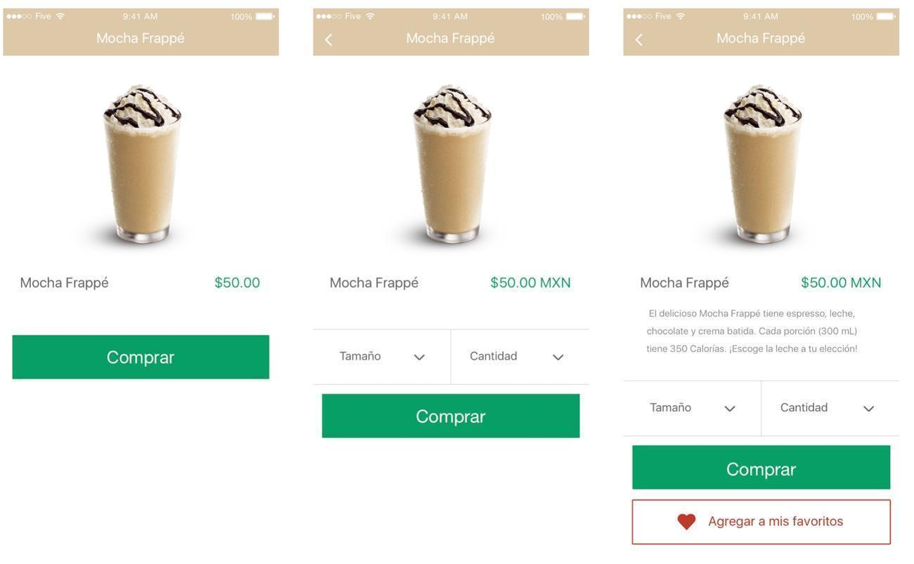

### Actividad de seguimiento
[Diapositiva 47](diapositivas/diapositiva-047.jpg)

- Exploración segura
- Gratificación instantánea
- Postergar elecciones
- Simplificar repeticiones
- Habituación
- Memoria espacial
- Memoria prospectiva
- Construcción incremental
- Micro interrupciones
- Suficientemente satisfactorio

---

## 7. Interfaz de usuario (UI)

### Foco en ordenadores: UI – *User interface*
[Diapositiva 48](diapositivas/diapositiva-048.jpg)

**Interfaz de usuario:** todos los elementos de un producto con los que el usuario interactúa.

### Relación UX → UI
[Diapositiva 49](diapositivas/diapositiva-049.jpg)

1. **UX** se enfoca en conocer al usuario y proponer una experiencia que satisfaga sus necesidades positivamente.
2. **UI** da forma al producto digital que permite dicha experiencia. **Principalmente visual.**

### Contenido y dispositivo
[Diapositiva 50](diapositivas/diapositiva-050.jpg)

Lo visual y la propia pantalla, teclado, ratón, etc.

### Factores determinantes en una UI: la pantalla
[Diapositivas 51–53](diapositivas/diapositiva-051.jpg)

Cualquier dispositivo con pantalla puede mostrar una interfaz, pero… párate a pensar si una interfaz, la misma, puede ser igualmente útil para dar una experiencia satisfactoria…

> El mismo diseño no funciona igual en una valla que en una tarjeta de visita: el soporte condiciona.

> **¿Qué tipos de pantallas conoces?**

### Factores determinantes en una UI: las características del dispositivo
[Diapositivas 54–57](diapositivas/diapositiva-054.jpg)

El/la diseñador/a UI debe considerar los **modos de interacción** que tiene la interfaz con el usuario, ya sea por las características del usuario o del dispositivo.

> ¿Qué es un modo de interacción?

**Capacidades del dispositivo:**

- ¿Contacto con el dedo? ¿Lápiz? ¿Ratón?
- ¿Se puede hacer doble clic? ¿Arrastrar?
- ¿Hay teclado?
- ¿Se reconoce la voz?
- ¿Cuáles son las proporciones y tamaños de la pantalla?
- ¿Se puede rotar?

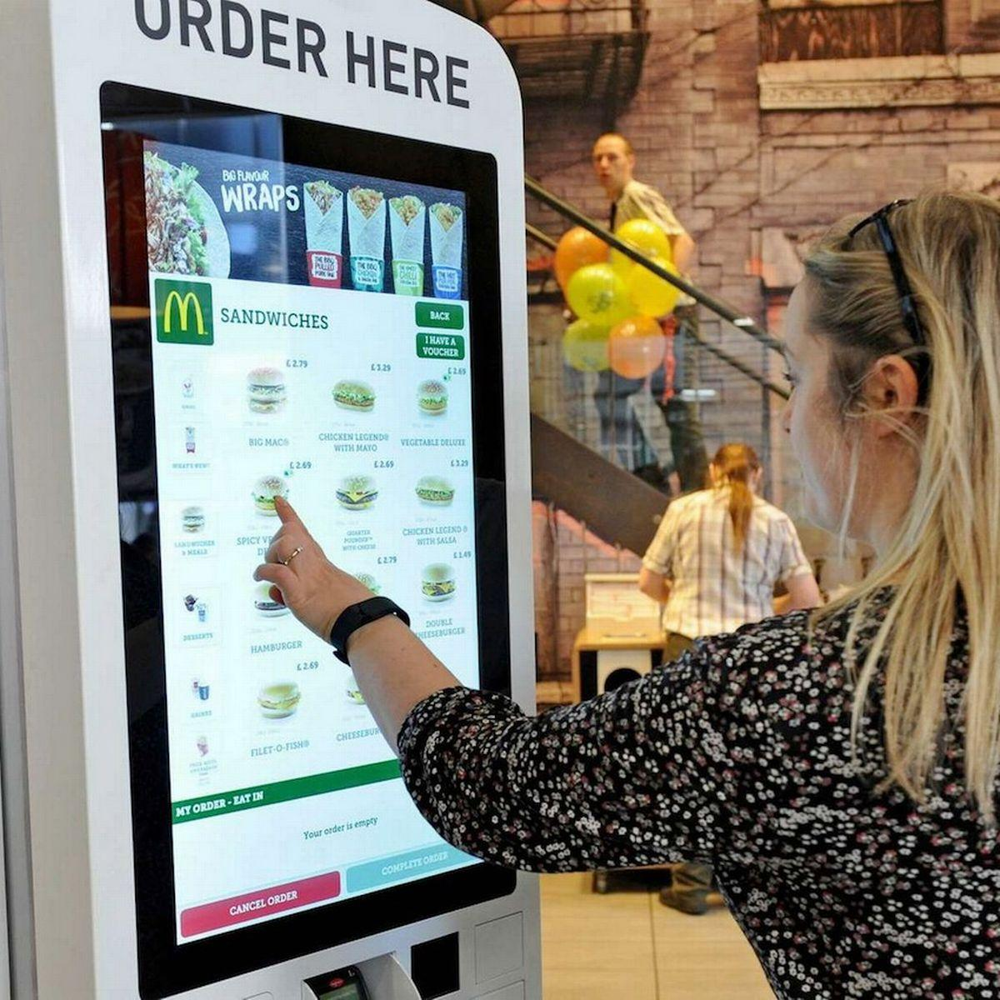
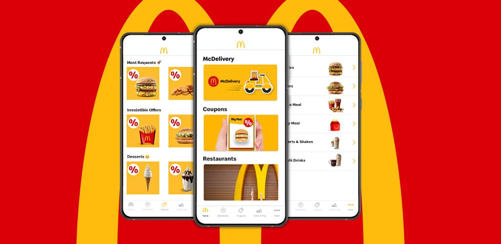
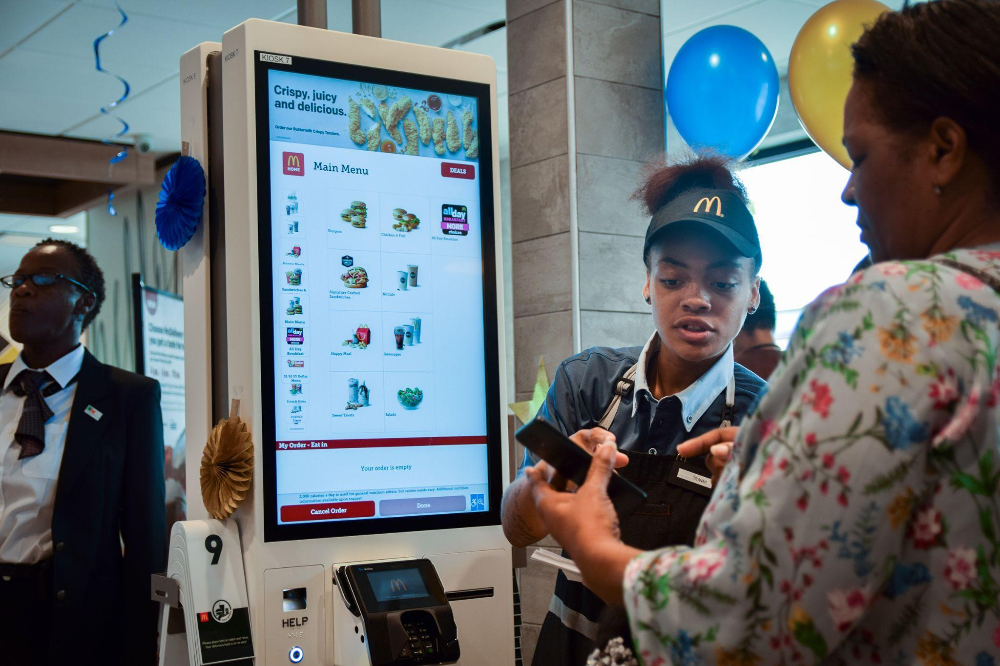

### Tipos principales de interfaces
[Diapositivas 58–64](diapositivas/diapositiva-058.jpg)

No todas las interfaces digitales son iguales. Tipos principales:

**Interfaz de lenguaje natural**

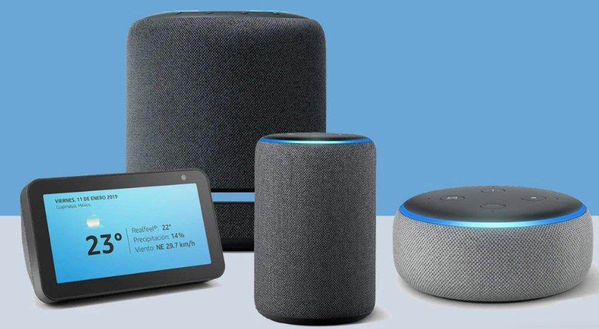

**Interfaz de preguntas y respuestas**

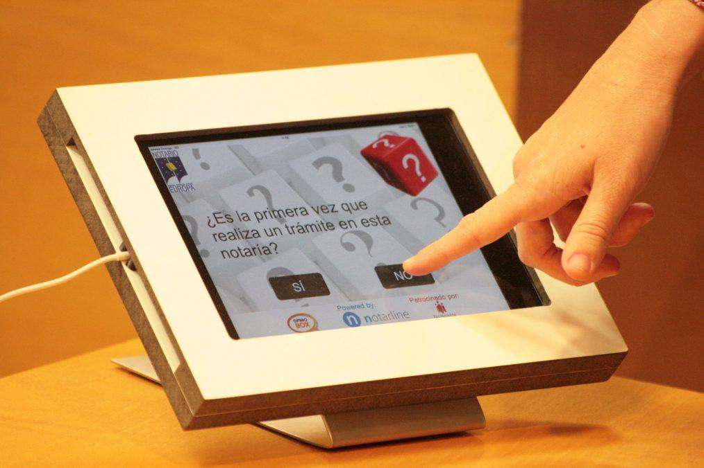
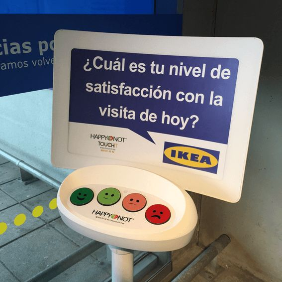
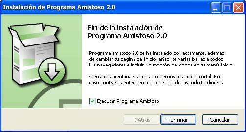

**CLI – *Command line interface* – Interfaz por línea de comandos**

Palabras clave y valores.

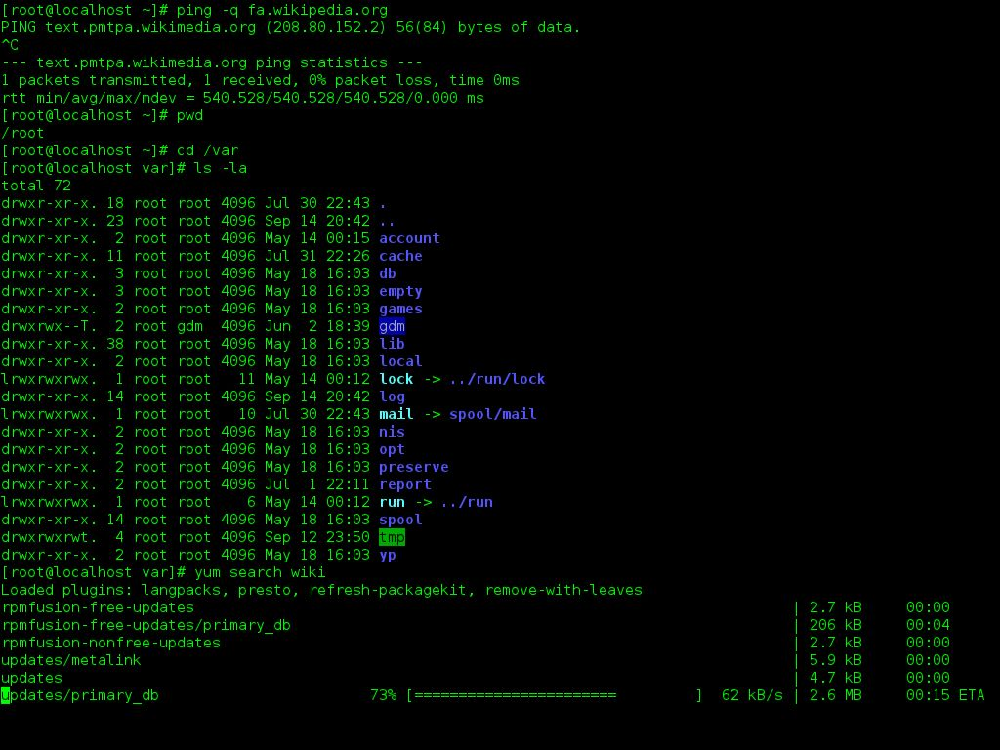

**GUI – *Graphic user interface* – Interfaz gráfica de usuario**

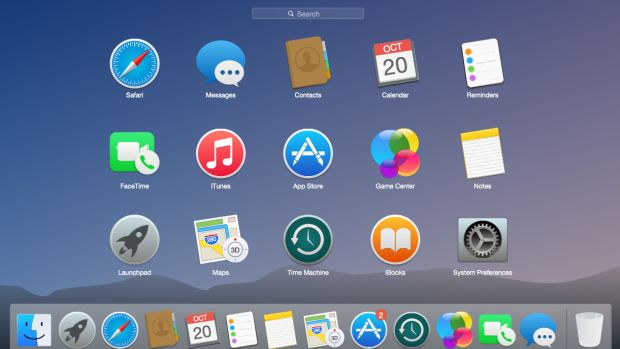
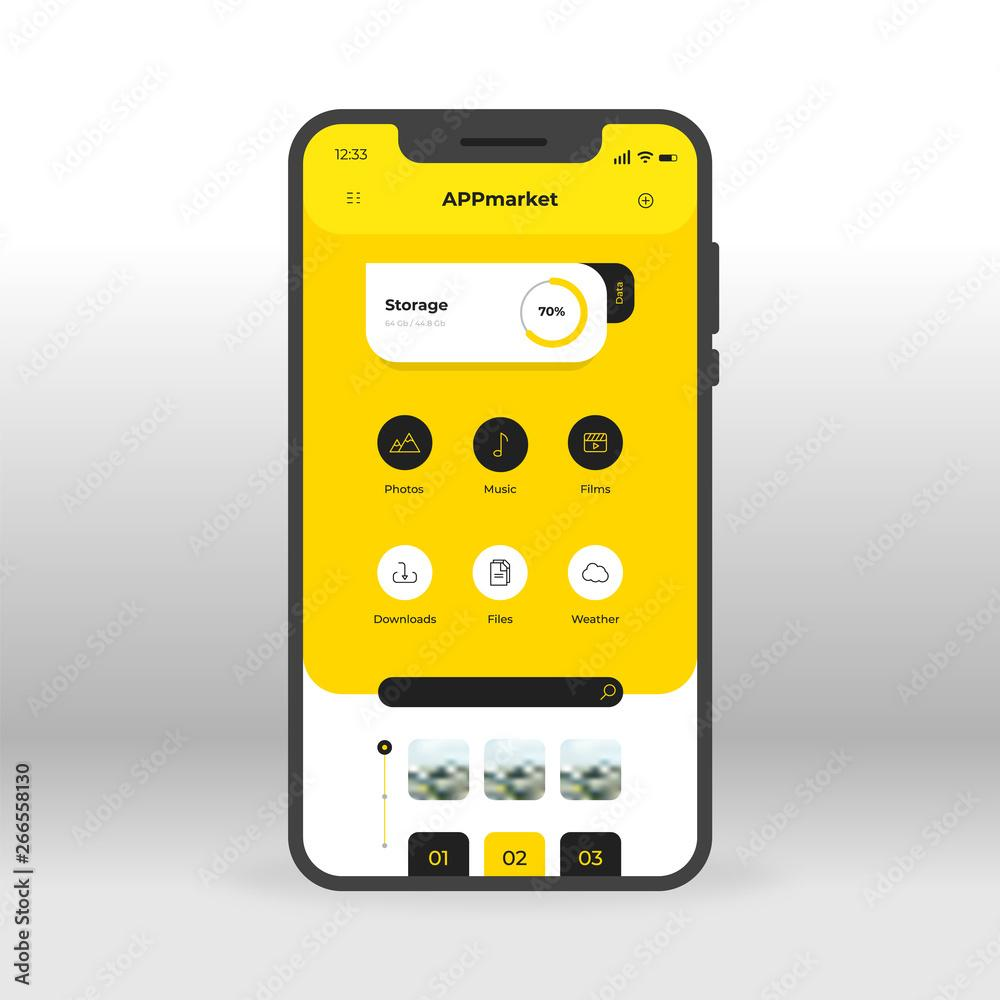

### El propósito del diseñador UI
[Diapositiva 65](diapositivas/diapositiva-065.jpg)

Crear una interfaz que satisfaga las necesidades de los usuarios de forma positiva.

### Material de trabajo de la diseñadora UI
[Diapositiva 66](diapositivas/diapositiva-066.jpg)

Seleccionará, distribuirá y estilizará:

- textos (títulos, claims, descripciones, etc.),
- imágenes,
- botones,
- campos del formulario, etc.

### Es de vital importancia
[Diapositiva 67](diapositivas/diapositiva-067.jpg)

Que la interfaz sea **accesible**, **usable**, **atractiva** y que favorezca la experiencia del usuario.

### Es nuestro perfil
[Diapositiva 68](diapositivas/diapositiva-068.jpg)

✅ El diseñador UI necesita tener conocimientos de **diseño gráfico**, psicología de la forma y del color, tipografía, composición, maquetación, etc., pues son parte fundamental del trabajo.

⬅️ También necesita **conocimientos informáticos** para comprender los dispositivos en los que su trabajo es mostrado y las tecnologías con las que su trabajo es producido.

 

### Actividades de un diseñador UI
[Diapositiva 69](diapositivas/diapositiva-069.jpg)

- Establece las líneas del diseño visual + guías de estilo.
- Diseño de los elementos y componentes (sistema de diseño).
- Diseño de interacción (prototipado) + guías de interacción.

---

## 8. Diseño de interacción (IxD)

### Foco en ordenadores: IxD – *Interaction design*
[Diapositiva 70](diapositivas/diapositiva-070.jpg)

Define las formas de operar la interfaz, de cómo el usuario se puede relacionar con la web y cómo esta le responde.

### Por ejemplo
[Diapositivas 71–72](diapositivas/diapositiva-071.jpg)

El usuario debe ingresar información al sistema: la dirección de su domicilio. Lo podemos hacer mediante un formulario.

**¿Qué tipo de decisiones sobre la interacción podemos tomar?**

- ¿El ingreso de información o selección de características se produce mediante teclado? ¿Ratón? ¿Táctil? ¿O una combinación de ellos?
- ¿Se utilizan desplegables o campos de texto?
- ¿El sistema te sugiere cómo completar o no?

### Contacto entre el usuario y el artefacto
[Diapositivas 73–74](diapositivas/diapositiva-073.jpg)

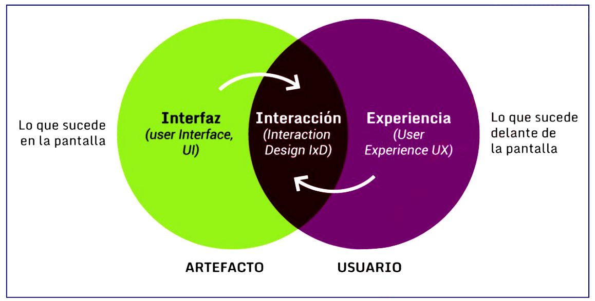

- **Interfaz** (*user interface*, UI): lo que sucede en la pantalla → ARTEFACTO.
- **Experiencia** (*user experience*, UX): lo que sucede delante de la pantalla → USUARIO.
- **Interacción** (*interaction design*, IxD): la intersección entre ambas.

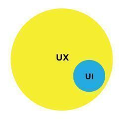

> La UI es una parte de la UX.

---

## 9. Otros profesionales: frontend y backend

### Desarrollo frontend
[Diapositiva 75](diapositivas/diapositiva-075.jpg)

Se encarga de la parte que el navegador muestra.

**No diseña, traduce.** Convierte, implementa, desarrolla, codifica los diseños creados por UX/UI.

Los lenguajes más utilizados son HTML, CSS y JavaScript.

Se encarga también de utilizar los datos que llegan del servidor para mostrarlos en pantalla o condicionar lo que vemos.

### Desarrollo backend
[Diapositiva 76](diapositivas/diapositiva-076.jpg)

Se encarga de la parte lógica del sitio web, de programar las funciones que tendrá el sitio, el diseño y desarrollo de la base de datos y la interacción con esta, administración del servidor, procesar datos de las peticiones de los clientes, etc… y, por supuesto, facilitar los datos que el frontend necesita.

[Diapositivas 77–80](diapositivas/diapositiva-077.jpg)

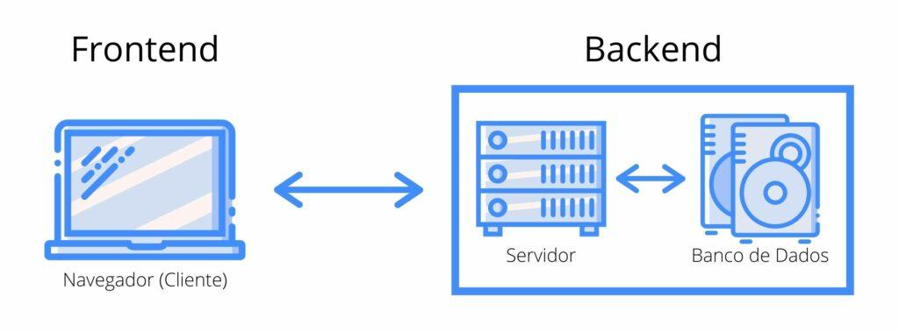

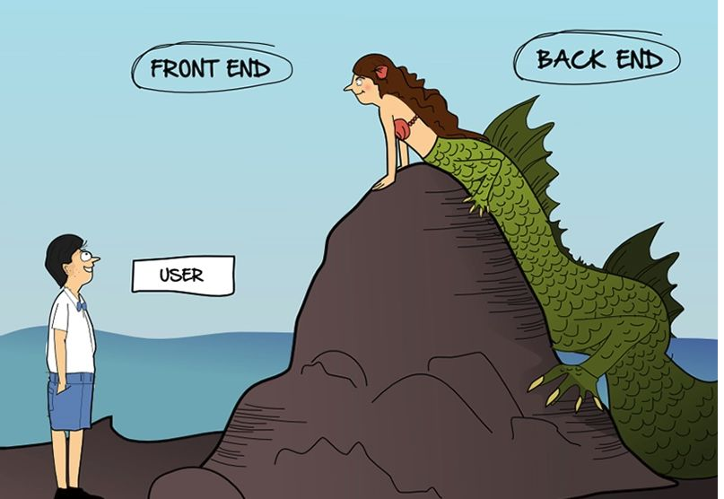
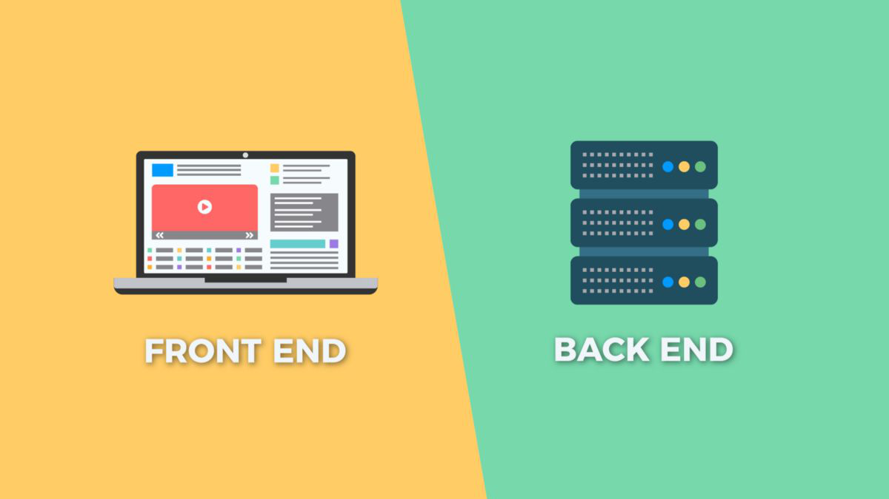

---

## 10. Arquitectura de la información

[Diapositiva 81](diapositivas/diapositiva-081.jpg)

### ¿Qué es la arquitectura de la información (aplicada a web)?
[Diapositiva 82](diapositivas/diapositiva-082.jpg)

**DECIDIR cómo ESTRUCTURAR el CONTENIDO.** ¿Según qué?

### Una buena arquitectura de la información busca…
[Diapositiva 83](diapositivas/diapositiva-083.jpg)

Organizar el contenido de forma **clara y lógica**, **según el modelo mental de los usuarios**, para facilitar al máximo el acceso a ella.

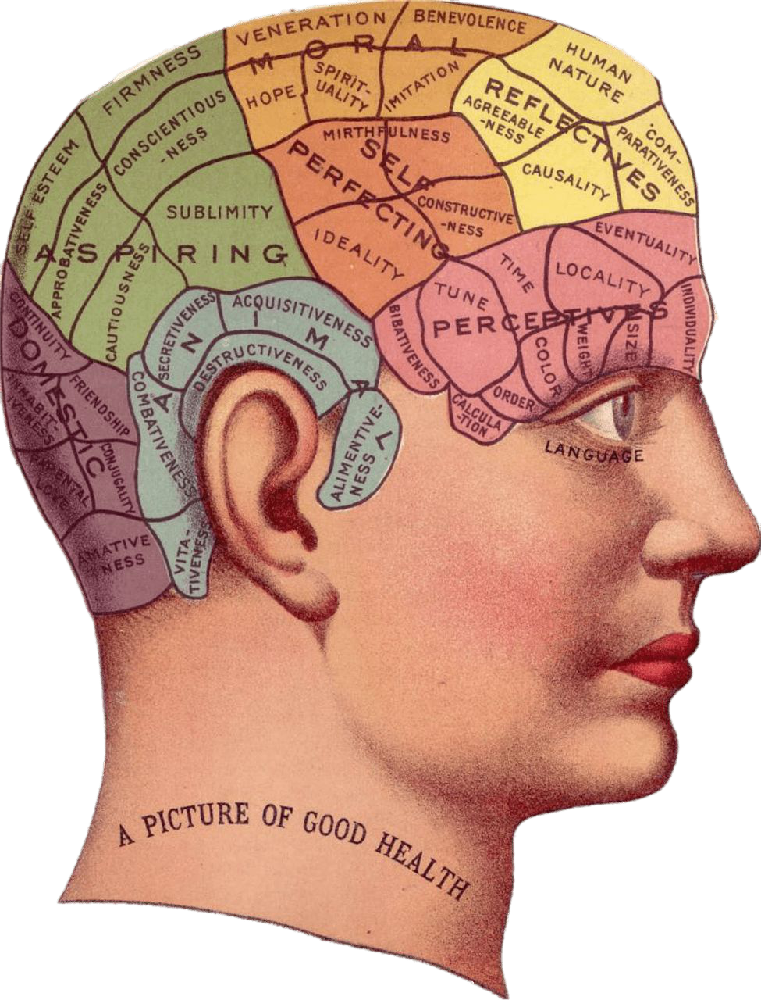

### Los 3 focos principales
[Diapositiva 84](diapositivas/diapositiva-084.jpg)

- **Organización**
- **Etiquetado**
- **Estructura**

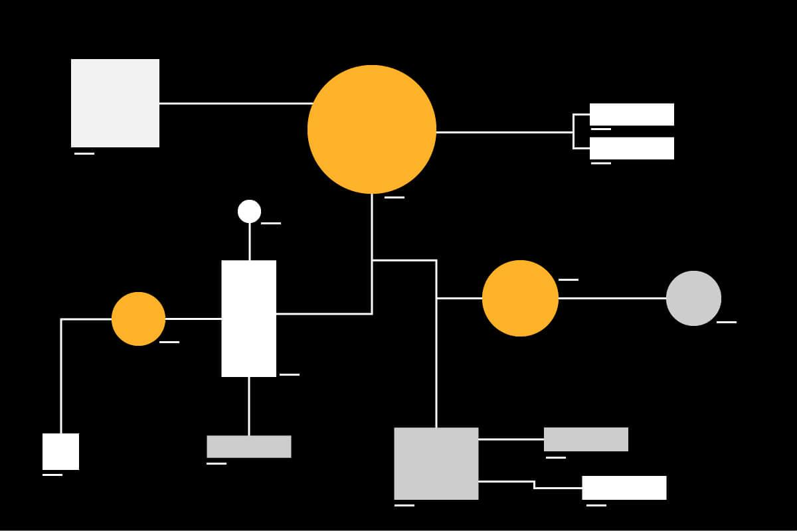

### Organización
[Diapositivas 85–90](diapositivas/diapositiva-089.jpg)

- **¿Qué hacemos?** Categorizar la información.
- **¿Cómo?** Generando agrupaciones de contenidos relacionados.
- **¿Para qué?** Para ayudar a los usuarios a encontrar, procesar y comprender lo que les interesa dentro de grandes cantidades de información.
- **Sí, ¿pero qué es lo que pretendemos?** Evitar la sobrecarga cognitiva del usuario.
- **No, ¡lo que pretendemos de verdad!** Que no cierre la web y el pedido sin terminar.

**Tipos más comunes de organización:** cronológica /// alfabética /// temática.

> Elaboremos un listado de ejemplos entre todas.

### Etiquetado
[Diapositivas 91–96](diapositivas/diapositiva-094.jpg)

- **¿Qué hacemos?** Definir la terminología que utilizará el sistema.
- **¿Cómo?** Eligiendo las palabras para títulos, encabezados, nombres de secciones, las palabras clave, productos y grupos de productos, transacciones, etc.
- **¿Puedo suponer que mi buena voluntad es suficiente?** No, idealmente, si hay presupuesto.
- **Entonces, ¿cómo lo hago?** Con un test UX a los usuarios, porque necesitamos conocer su pensamiento, cómo le llamarían, cómo lo buscarían, si entienden la terminología, etc.

> **¿Cuál es la prueba UX más acorde?**

**Ejemplo: “Devoluciones” en diferentes empresas**
[Diapositiva 96](diapositivas/diapositiva-096.jpg)

| Empresa | Etiqueta |
|---|---|
| Zara | Cambios y devoluciones |
| Mango | Devoluciones, cambios y reembolsos |
| El Corte Inglés | Devolución y reembolso |
| MediaMarkt | Devoluciones |
| PcComponentes | Devoluciones y garantías |
| Mercadona | Quiero devolver / cambiar un producto |
| pcacierto.com | Devoluciones y reclamaciones |

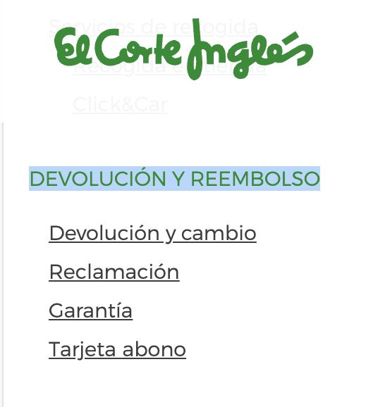

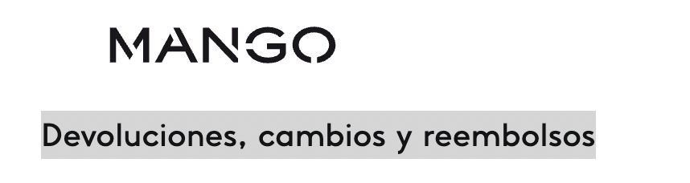
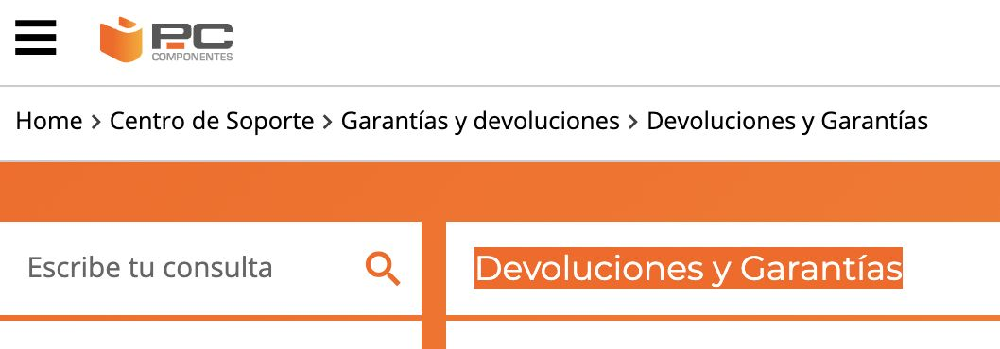

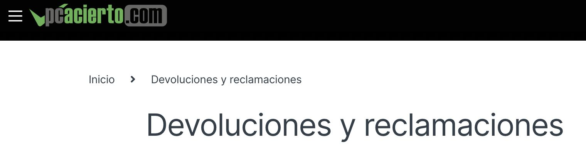
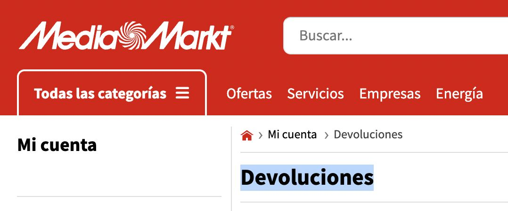

### Estructura
[Diapositivas 97–101](diapositivas/diapositiva-101.jpg)

- **¿Qué hacemos?** Definir el modelo de navegación y las herramientas de búsqueda.
- **¿Y si no lo hacemos bien?** Los usuarios ignorarán la navegación si no cumple con sus expectativas.
- **¿Por qué puede ocurrir eso?** Porque NO les parece natural, previsible y familiar o no lleva a donde el usuario esperaba.
- **¿Cómo nos aseguramos de que cumple?** Considerar las experiencias previas y los patrones más repetidos.
- **¡Suena complejo!** Lo es. Es un compendio de aspectos relacionados con la agrupación, profundidad y etiquetado de los contenidos.

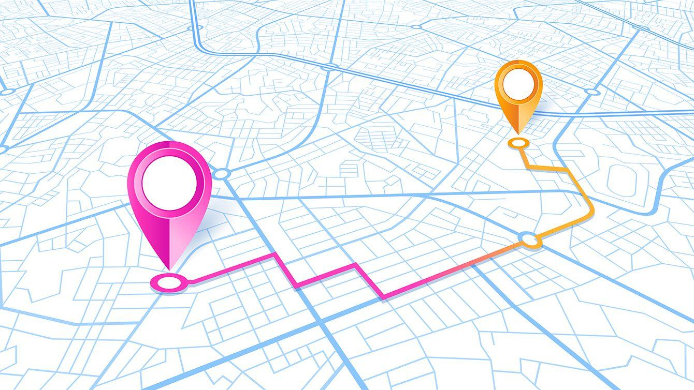
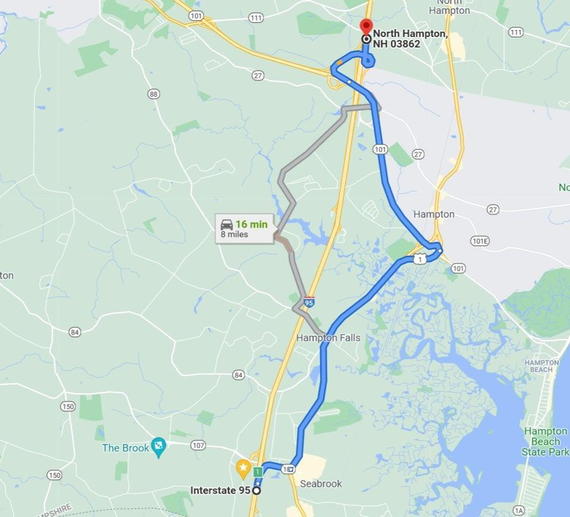

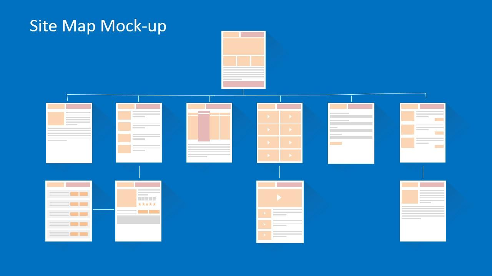

### Tipos de estructura
Arquitectura de la información :: Estructura :: Tipos

#### Jerárquica
[Diapositivas 102–103](diapositivas/diapositiva-102.jpg)

- Navegación en forma de árbol.
- Se organiza de lo general a lo concreto.
- Es de las más populares.

**Ventaja:** el usuario puede hacerse un mapa mental del sitio y saber dónde está, qué categoría está viendo, cómo ha llegado, etc.

**Inconveniente:** para ir a otro sitio debe volver sobre sus pasos o comenzar de nuevo y tomar decisiones diferentes. No se permite la libre navegación.

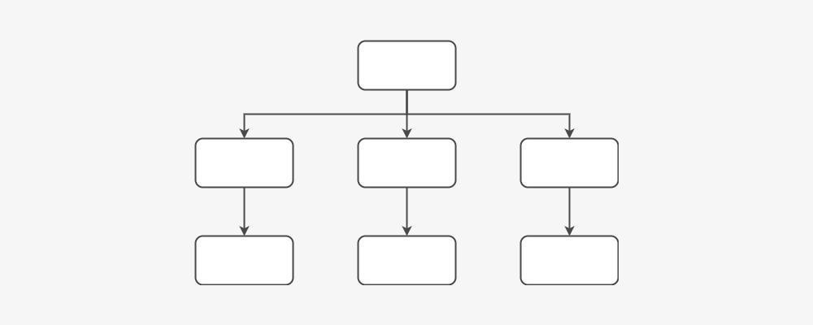

#### Hipertexto
[Diapositivas 104–105](diapositivas/diapositiva-104.jpg)

La información no se organiza de forma lineal. Los bloques están conectados por cualquier tipo de asociación.

**Ventaja:** más libre y flexible. Las asociaciones y relaciones de contenido permiten enriquecer la experiencia del usuario.

**Inconveniente:** es difícil para los usuarios entender el sistema, memorizar un recorrido o encontrar lo que buscan de una forma directa.

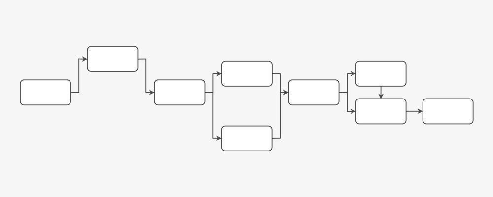

#### Navegación plana o lineal
[Diapositivas 106–107](diapositivas/diapositiva-106.jpg)

Desde un bloque de información se puede pasar solo al siguiente o solo al anterior.

**Ventaja:** útil si deseamos que el usuario siga un itinerario fijo y guiado, evitando que otros bloques causen distracción.

**Inconveniente:** solo posible cuando el volumen de información o su tipología es simple o las opciones que tiene el usuario son reducidas.

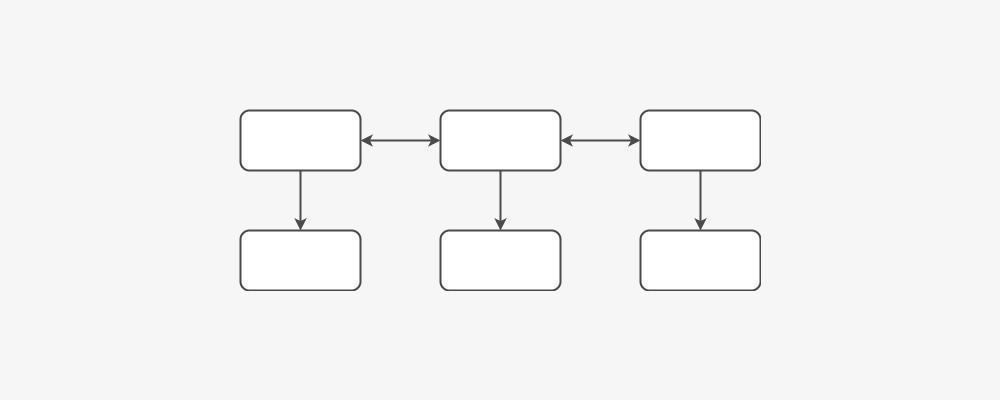

#### Navegación de red
[Diapositivas 108–109](diapositivas/diapositiva-108.jpg)

Desde el origen se accede a otros bloques sin orden aparente. **HAY LÓGICA, PERO NO HAY ORDEN** (primero, segundo, etc.).

**Ventaja:** es una estructura más libre que permite organizar información relacionada pero de tipologías dispares.

**Inconveniente:** no recomendable para cantidades de información muy grandes. El usuario se desorientará y no sabrá dónde se encuentra.

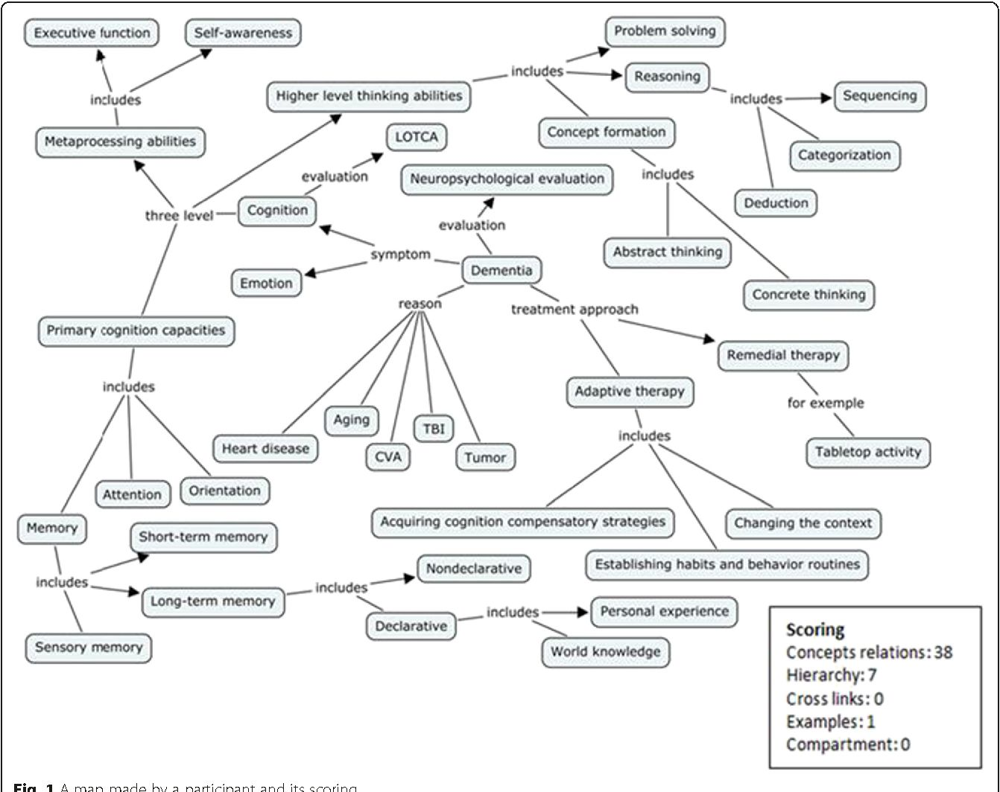

### Tarea
[Diapositiva 110](diapositivas/diapositiva-110.jpg)

**T2 – Práctica 1: Arquitectura de la información.**

---

## 11. Usabilidad

### Introducción: objetos difíciles de usar
[Diapositivas 111–113](diapositivas/diapositiva-111.jpg)

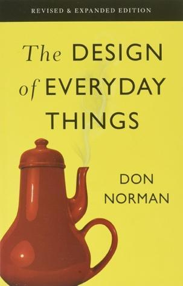

*(no) Norman door* — referencia a Don Norman, *The Design of Everyday Things*.

### ¿Qué es la usabilidad?
[Diapositivas 114–115](diapositivas/diapositiva-115.jpg)

> “El grado en que un producto (1) puede ser utilizado, (2) en un contexto de uso específico, (3) por determinados usuarios, (4) para conseguir objetivos específicos, (5) con efectividad, eficiencia y satisfacción”.
> — ISO (International Organization for Standardization)

### Una web usable es…
[Diapositiva 116](diapositivas/diapositiva-116.jpg)

La que garantiza a sus usuarios (de su público objetivo) acceder a todos los contenidos y realizar las acciones que desean de forma **rápida, sencilla y gratificante**.

Una web **no usable** es aquella que no permite a los usuarios alcanzar sus objetivos o completar las tareas que necesitan hacer.

### Para una web usable, debemos:
[Diapositiva 117](diapositivas/diapositiva-117.jpg)

- Satisfacer las necesidades del usuario por encima de todo.
- Dar el control al usuario (que tenga la sensación de controlar el sistema).
- Garantizar acceso fácil a la información y acciones.
- Dar respuesta inmediata a las acciones (siempre sabe qué está pasando).
- Ofrecer una interfaz consistente (que siempre sienta estar en el mismo sistema).
- Tratar los errores y evitar que se produzcan otros.
- Que el usuario no tenga que memorizar nada (o poco).

### Los 10 principios heurísticos de Jakob Nielsen
[Diapositiva 118](diapositivas/diapositiva-118.jpg)

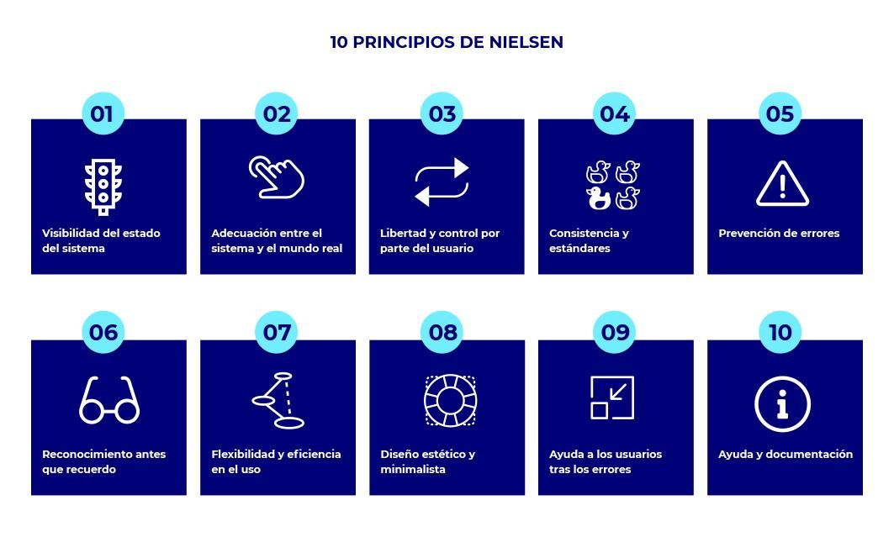

1. Visibilidad del estado del sistema
2. Adecuación entre el sistema y el mundo real
3. Libertad y control por parte del usuario
4. Consistencia y estándares
5. Prevención de errores
6. Reconocimiento antes que recuerdo
7. Flexibilidad y eficiencia en el uso
8. Diseño estético y minimalista
9. Ayuda a los usuarios tras los errores
10. Ayuda y documentación

### No confundir
[Diapositiva 119](diapositivas/diapositiva-119.jpg)

- **Experiencia de usuario:** interacción del usuario con un entorno o dispositivo que genera una **percepción positiva o negativa** del servicio, producto o dispositivo.
- **Usabilidad:** facilidad con que las personas pueden utilizar una herramienta u objeto fabricado por humanos con el fin de alcanzar un objetivo concreto.

La usabilidad **influye en** la experiencia de usuario.

### La fórmula
[Diapositiva 120](diapositivas/diapositiva-120.jpg)

> Alto grado de usabilidad
> \+ buena experiencia de usuario
> = **experiencias relevantes del usuario con la marca**
> = beneficio tangible para nuestro cliente

### ¿Cómo comprobamos la usabilidad web?
[Diapositiva 121](diapositivas/diapositiva-121.jpg)

(De la web, de un componente, de una página)

- Análisis heurístico.
- Como mínimo, los usuarios pueden contestar a:
  - ¿Dónde estoy?
  - ¿Cómo llegué aquí?
  - ¿A dónde puedo ir después?
  - ¿Qué puedo hacer en este momento?
  - ¿Cómo puedo regresar al punto anterior?

### Usabilidad y navegación
[Diapositivas 122–123](diapositivas/diapositiva-122.jpg)

El sistema de navegación de una web requiere de alto grado de interacción del usuario con el sitio, por lo que hay que tener especial cuidado a la hora de diseñarlo.

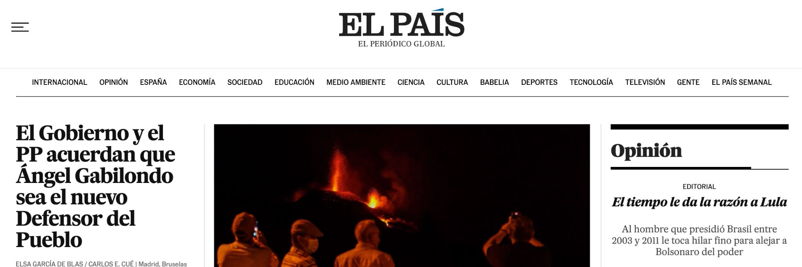

Si el usuario debe imaginar **qué** puede encontrar, **dónde** se encuentra, **cómo se llama** lo que busca… es probable que se frustre y abandone la página.

### Sin hacer un máster
[Diapositiva 124](diapositivas/diapositiva-124.jpg)

**El uso debe ser cómodo independientemente de los conocimientos técnicos y el grado de experiencia del usuario.**

- **Conocimientos:** si es necesario aprender a navegar por tu página es que necesitas mejorarlo.
- **Experiencia previa:** si va en contra de lo que el usuario ya conoce, este terminará por abandonar la página.

### La usabilidad aumenta cuando…
[Diapositiva 125](diapositivas/diapositiva-125.jpg)

- El usuario es capaz de predecir el funcionamiento al ver la web.
- El usuario intuye la respuesta del sitio al interactuar con él.

Para ello son imprescindibles los siguientes rasgos:

### Rasgos para la usabilidad
[Diapositivas 126–137](diapositivas/diapositiva-126.jpg)

**Consistencia.** Los elementos son coherentes en todas las páginas en cuanto a su diseño, funcionalidad y comportamiento.

**Persistencia.** Los elementos se colocan siempre en el mismo sitio y el mismo orden. Por regla general, las barras de navegación o búsqueda se colocan a lo ancho de la página, en su parte superior, por debajo del encabezado o formando parte de él.

**Familiaridad.** Si el sistema de navegación le recuerda al usuario a situaciones a las que ya está acostumbrado, tendrá menos dificultad en adaptarse a él.

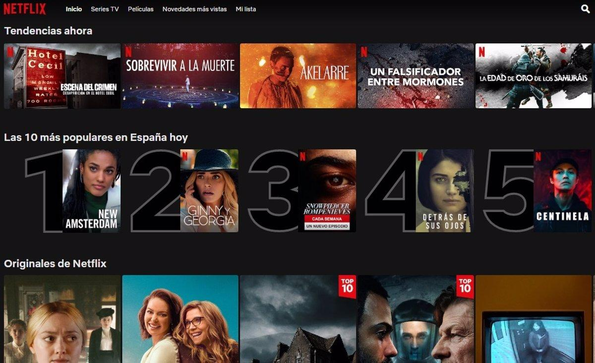
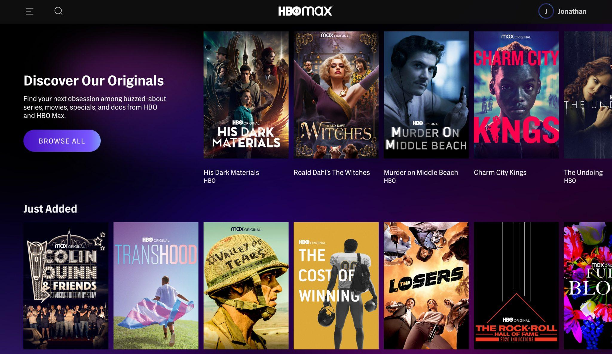

> Netflix y HBO Max comparten patrones de interfaz: el usuario de una se siente familiarizado con la otra.

**Facilidad de aprendizaje.** Que el usuario pueda realizar las tareas desde el primer contacto con el sitio o cuánto se tarda en aprender a usarlo.

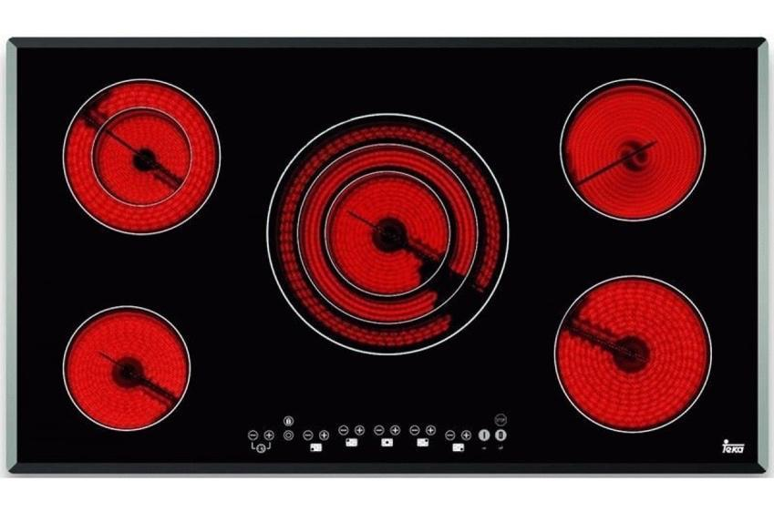

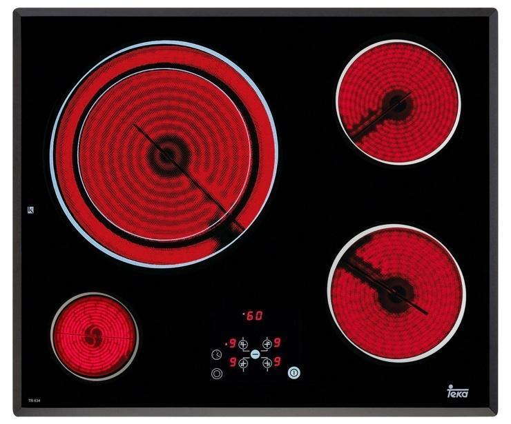

> ¿Qué vitrocerámica permite saber a la primera qué mando controla cada fuego? (*mapeo natural*).

**Eficiencia.** Cuando el usuario ya conoce el diseño, cómo de fácil es conseguir sus metas.

**Memorabilidad.** La persistencia de la experiencia en su memoria que facilita un nuevo uso eficaz pasado el tiempo.

**Utilidad.** Si el sistema cumple realmente los objetivos y satisface necesidades del usuario.

### Componentes que facilitan la navegación y usabilidad
[Diapositiva 138](diapositivas/diapositiva-138.jpg)

Cuando diseñamos un sistema de navegación, tenemos que dar acceso a todos los contenidos y facilitar al usuario respuestas a sus posibles preguntas:

- ¿Dónde estoy?
- ¿Cómo llegué aquí?
- ¿A dónde puedo ir después?
- ¿Qué puedo hacer en este momento?
- ¿Cómo puedo regresar al punto anterior?

### El sistema de navegación se compone de:
[Diapositivas 139–142](diapositivas/diapositiva-139.jpg)

1. **Menú principal:** permite acceder a los lugares más relevantes de un sitio web + búsqueda (recomendada).

   

2. **Menú secundario o enlaces en página:** dan acceso a contenido secundario o accesos directos a secciones del menú principal.

   

3. **Enlaces en contenido:** dan acceso a otras secciones internas o externas relacionadas con el contenido consultado. **¡¡BUSQUEMOS!!**

   

4. **Menú terciario o en pie de página:** dan acceso a información secundaria para el usuario o que la web está obligada a mostrar.

   

---

## 12. Accesibilidad

[Diapositiva 143](diapositivas/diapositiva-143.jpg)

### ¿Qué es la accesibilidad?
[Diapositiva 144](diapositivas/diapositiva-144.jpg)

La posibilidad de que una web pueda ser accedida y usada por el **mayor número posible de personas**, independientemente de las limitaciones.

> ¿Qué limitaciones pueden existir?

### Limitaciones a considerar para la accesibilidad web
[Diapositiva 145](diapositivas/diapositiva-145.jpg)

- Propias del individuo (discapacidades, idioma, conocimientos, experiencia, etc.).
- Tecnológicas.
- Ambientales.

### ¿Es posible…?
[Diapositiva 146](diapositivas/diapositiva-146.jpg)

> ¿Accesibilidad sin usabilidad, o usabilidad sin accesibilidad?

### Un diseño será accesible cuando…
[Diapositiva 147](diapositivas/diapositiva-147.jpg)

…sea usable para más personas, en más contextos de uso, posibilitando a todos los usuarios la realización y consecución de tareas de forma eficiente y satisfactoria.

### Relevancia de la accesibilidad web: la infoexclusión
[Diapositivas 148–149](diapositivas/diapositiva-148.jpg)

A pesar de la información y las tecnologías disponibles, se produce **“infoexclusión”**: que los usuarios con dificultades de acceso no puedan acceder a la WWW.

> ¡Recuerda! Las dificultades no son solo por causa de diversidad funcional.

### Comisión “eEurope 2002”
[Diapositiva 150](diapositivas/diapositiva-150.jpg)

> “El objetivo de la comunicación es conseguir que los sitios web públicos sean más fácilmente accesibles para los **37 millones de ciudadanos de la UE** que sufren alguna **discapacidad y para los ancianos**, un colectivo en constante crecimiento.
>
> Ambos grupos sociales corren el riesgo de quedar excluidos del acceso a los sitios web debido a **obstáculos técnicos**, la mayoría de los cuales **podría eliminarse** empleando técnicas específicas de **diseño** de sitios web basadas, a su vez, en normas relativas a los **contenidos**, la **estructura** y la **codificación** de dichos sitios.”

### Datos
[Diapositiva 151](diapositivas/diapositiva-151.jpg)

Ciudadanos con algún tipo de discapacidad:

- España 9% (INE, 2002)
- Estados Unidos 20% (US Census, 1997)
- **Usuarios de la Web 9,2% (GVU, 1998)**

Es predecible que el porcentaje de la población con discapacidades se incremente a lo largo de los próximos años, debido al progresivo aumento de la longevidad entre la población.

### Persona Spectrum (Microsoft Inclusive Design)
[Diapositiva 152](diapositivas/diapositiva-152.jpg)

| | Permanente | Temporal | Situacional |
|---|---|---|---|
| **Tacto** | Un brazo | Brazo lesionado | Madre/padre primerizo (bebé en brazos) |
| **Vista** | Ceguera | Cataratas | Conductor distraído |
| **Oído** | Sordera | Infección de oído | Camarero (entorno ruidoso) |
| **Habla** | No verbal | Laringitis | Acento marcado |

> “Usamos el Persona Spectrum para entender desajustes y motivaciones relacionadas en un espectro de escenarios permanentes, temporales y situacionales. Es una herramienta rápida para fomentar la empatía y mostrar cómo una solución escala a un público más amplio.”

### Limitaciones de acceso: por discapacidades
[Diapositivas 153–154](diapositivas/diapositiva-153.jpg)

- **Visuales:** ceguera, visión reducida y problemas en la visualización del color (como el daltonismo).
- **Auditivas:** sordera o hipoacusia. Debido a que el canal sonoro es mucho menos utilizado en interfaces web que el canal visual, puede considerarse un limitante menor o solo en algunos tipos de contenidos.
- **Motrices:** relacionadas con la capacidad de movilidad del usuario. Estos no podrán interactuar con el sistema de forma tradicional (ratón, teclado, dedo), por lo que utilizan dispositivos alternativos, por ejemplo, basados en voz.
- **Cognitivas y de lenguaje:** usuarios que presentan problemas en el uso del lenguaje, la lectura, percepción, memoria, salud mental, etc.

Estas discapacidades no tienen por qué ser excluyentes entre sí.

### Limitaciones de acceso: por tecnología o ambiente
[Diapositiva 155](diapositivas/diapositiva-155.jpg)

Existen otras limitaciones derivadas del:

- **Contexto de uso:** iluminación, visibilidad, etc.
- **Dispositivo de acceso empleado:** hardware y/o software.
- **Conexión utilizada:** alta o baja velocidad, interrupciones de conexión.

### Paralelismos
[Diapositiva 156](diapositivas/diapositiva-156.jpg)

Comparten el mismo problema de visualización aquellos usuarios con visión reducida, con aquellos que utilicen pantallas pequeñas o accedan desde entornos llenos de humo.

### WIN-WIN
[Diapositiva 157](diapositivas/diapositiva-157.jpg)

Un producto accesible para personas con discapacidades posibilitará y facilitará el acceso también a usuarios en contextos desfavorables y con otras limitaciones.

**Una sola acción aumenta doblemente el número de usuarios beneficiados por un diseño accesible.**

### Tecnología asistencial
[Diapositiva 158](diapositivas/diapositiva-158.jpg)

Es el conjunto de equipos, dispositivos, instrumentos o programas para mejorar la calidad de vida de aquellas personas que tienen algún tipo de discapacidad. Ayuda a realizar tareas que no podrían hacer de otra manera; incrementa su autonomía.

### Tecnologías asistenciales para discapacidad visual
[Diapositiva 159](diapositivas/diapositiva-159.jpg)

**Dispositivos de entrada**

- Teclados: virtual, alternativo, Braille.
- Software de reconocimiento de voz.
- Apuntadores: licornios.
- Webcams para seguimiento de ojos o cara.

**Dispositivos de salida**

- Lectores de pantalla.
- Ampliadores de pantalla.
- Navegadores para ciegos.

### ¿Cómo pueden contribuir los/as diseñadores/as web a la accesibilidad?
[Diapositiva 160](diapositivas/diapositiva-160.jpg)

### W3C y WAI
[Diapositivas 161–162](diapositivas/diapositiva-161.jpg)

**W3C** es una comunidad internacional que desarrolla estándares y tecnologías (especificaciones, líneas maestras, software y herramientas) para guiar la Web hacia su máximo potencial.

Dentro de W3C se encuentra la **Iniciativa para la Accesibilidad Web (WAI)**, que desarrolla estrategias, directrices y recursos para ayudar a hacer la Web accesible a las personas con discapacidad.

### Pautas de Accesibilidad al Contenido en la Web (WCAG 2.0)
[Diapositivas 163–166](diapositivas/diapositiva-163.jpg)

#### Principio 1: Perceptible
Los componentes de la interfaz deben poder ser percibidos por todos los usuarios, por lo que deben ser “percibibles” por algún sentido del usuario.

1. Texto descriptivo para imágenes, mapas, enlaces, botones, etc.
2. Alternativas para multimedia (subtítulos, lengua de signos).
3. Contenido que pueda ser presentado de diferentes maneras sin perder información ni estructura.
4. Facilitar aumento de letra y de contraste.
5. En contenido audiovisual, evitaremos voz en off + música.

#### Principio 2: Operable
Los componentes de la interfaz no pueden exigir una interacción imposible de realizar para los usuarios.

1. Toda la funcionalidad disponible desde el teclado.
2. Tiempo suficiente para leer y usar el contenido.
3. Evitar contenido que pueda causar convulsiones.
4. Medios que sirvan de ayuda a los usuarios a la hora de navegar, localizar contenido y determinar dónde se encuentran.
5. Elementos de interacción operables lo suficientemente grandes y con el espacio necesario para que las personas con discapacidad motriz puedan interactuar.

#### Principio 3: Comprensible
La interfaz, su funcionamiento y la información presentada deben poder ser comprendidas por los usuarios.

1. Contenido textual legible y comprensible: lenguaje claro y sencillo para facilitar la comprensión a las personas con discapacidad cognitiva; nombres significativos en los enlaces para los lectores de pantalla.
2. Apariencia y operatividad predecibles. Repite patrones de comportamiento.
3. Ayudar a los usuarios a evitar los errores y a corregirlos.

#### Principio 4: Robusto
El avance en las tecnologías no debe impedir que el contenido siga siendo accesible.

1. Maximizar la compatibilidad con los agentes de usuario actuales y futuros, incluyendo las tecnologías asistidas.

### Niveles de accesibilidad
[Diapositiva 167](diapositivas/diapositiva-167.jpg)

Los niveles de accesibilidad se agrupan por bloques de puntos cumplidos y cada bloque implica una letra “A” en la puntuación de accesibilidad.

**100% accesible = WAI AAA o *Triple A***

Para medir la accesibilidad de un sitio web se pueden utilizar herramientas en línea como [TAW](https://www.tawdis.net/).

### Recurso
[Diapositiva 169](diapositivas/diapositiva-169.jpg)

- W3C WAI – Consejos de diseño para la accesibilidad: <https://www.w3.org/WAI/tips/designing/>

---

## Anexo: recursos gráficos de la plantilla

Fondos y elementos decorativos de la presentación, útiles para mantener la identidad visual en los SCORM:

| Archivo | Uso |
|---|---|
| [img-d001-01.png](imagenes/img-d001-01.png), [img-d001-02.png](imagenes/img-d001-02.png) | Fondos de portada (placa de circuito en gris) |
| [img-d002-01.png](imagenes/img-d002-01.png) | Fondo de diapositivas de sección (circuito en diagonal) |
| [img-d015-01.jpg](imagenes/img-d015-01.jpg), [img-d015-02.jpg](imagenes/img-d015-02.jpg), [img-d015-03.jpg](imagenes/img-d015-03.jpg) | Fotografías recortadas en franjas diagonales (diapositiva 15) |
| [img-d016-01.png](imagenes/img-d016-01.png), [img-d016-02.png](imagenes/img-d016-02.png), [img-d016-03.png](imagenes/img-d016-03.png), [img-d016-04.png](imagenes/img-d016-04.png) | Segmentos del gráfico circular de la diapositiva 16 |

Paleta de la plantilla (muestreada de las diapositivas): fondo azul noche `#1A202C`, amarillo de acento `#EECE1B`, verde menta `#81C7A5`, azul `#0144AC`, texto `#FFFFFF`.
